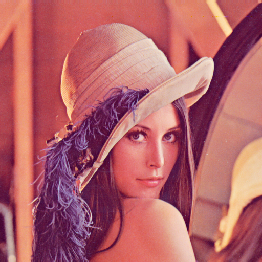

# Mini Project 1 — Image Restoration

**Mata Kuliah:** Pengolahan Citra dan Video

**Cakupan Materi:** Pertemuan 1–7 (Intensity Transformation, Histogram, Spatial Filtering, Sharpening, Frequency Domain)

**Batas Pengumpulan:** Minggu ke-9

---

## Deskripsi Tugas

Anda diberikan sebuah citra **Lena** yang telah mengalami kerusakan berupa:

- **Low contrast** (rentang intensitas sempit)
- **Gaussian noise** (noise acak berdistribusi normal)
- **Salt-and-pepper noise** (piksel hitam dan putih acak)
- **Blur** (detail citra menjadi kabur)

Tugas Anda adalah **merestorasi citra tersebut** sehingga mendekati kualitas citra aslinya menggunakan teknik-teknik pengolahan citra yang telah dipelajari di kelas.

---

## Citra Input

### Citra Original (Referensi)


### Citra Rusak (Input Tugas)


> **Download citra rusak di atas sebagai input program Anda.**

---

## Persyaratan Teknis

### Wajib
1. **Bahasa:** Python
2. **Library yang diizinkan:**
   - `numpy` — untuk semua operasi pengolahan citra
   - `cv2` (OpenCV) — **hanya** untuk membaca (`cv2.imread`) dan menampilkan/menyimpan (`cv2.imshow`, `cv2.imwrite`) citra
   - `matplotlib` — untuk visualisasi (plot, histogram, dsb.)
3. **Fungsi cv2 processing DILARANG:**
   - `cv2.GaussianBlur`, `cv2.medianBlur`, `cv2.filter2D`, `cv2.equalizeHist`, dan fungsi pengolahan cv2 lainnya
   - Semua operasi filtering, histogram, dan transformasi **wajib diimplementasikan manual menggunakan NumPy**

### Pipeline Restorasi yang Diharapkan
Anda bebas menentukan urutan dan kombinasi teknik, namun pipeline umumnya meliputi:

| Langkah | Teknik | Tujuan |
|---------|--------|--------|
| 1 | Denoising (Median / Gaussian filter manual) | Menghilangkan salt-and-pepper dan Gaussian noise |
| 2 | Histogram Equalization (manual) | Memperbaiki kontras yang rendah |
| 3 | Sharpening (Unsharp Masking / Laplacian manual) | Mempertajam detail yang kabur |

> Urutan di atas adalah **saran**, bukan kewajiban. Anda boleh menggunakan pendekatan lain selama hasilnya baik dan dapat dijelaskan.

---

## Deliverables

Kumpulkan dalam **satu repository GitHub** dengan struktur:

```
mp1-image-restoration/
├── README.md              # Penjelasan pendekatan & cara menjalankan
├── restoration.py         # atau .ipynb (Jupyter Notebook)
├── input/
│   └── lena_noisy.png     # Citra input (rusak)
└── output/
    └── lena_restored.png  # Hasil restorasi
```

### README.md harus berisi:
1. **Nama & NRP** 
2. **Penjelasan pipeline** restorasi yang digunakan (teknik apa, kenapa dipilih, urutan)
3. **Perbandingan visual** sebelum vs sesudah (screenshot/embed gambar)
4. **Analisis singkat** — apa yang berhasil, apa yang bisa ditingkatkan
5. **Cara menjalankan** program

---

## Pengumpulan

- **Format:** Submit link repository GitHub ke Google Sheet yang telah disediakan
- **Deadline:** **Minggu ke-9**

---

## Tips

- Mulai dengan menampilkan **histogram** citra rusak untuk memahami distribusi intensitasnya
- Coba setiap teknik **satu per satu** dulu, lihat efeknya, baru kombinasikan
- **Median filter** sangat efektif untuk salt-and-pepper noise
- **Histogram equalization** bisa dilakukan sebelum atau sesudah denoising — eksperimen mana yang lebih baik
- Jangan lupa **clipping** nilai piksel ke range 0–255 setelah setiap operasi

Selamat mengerjakan!
