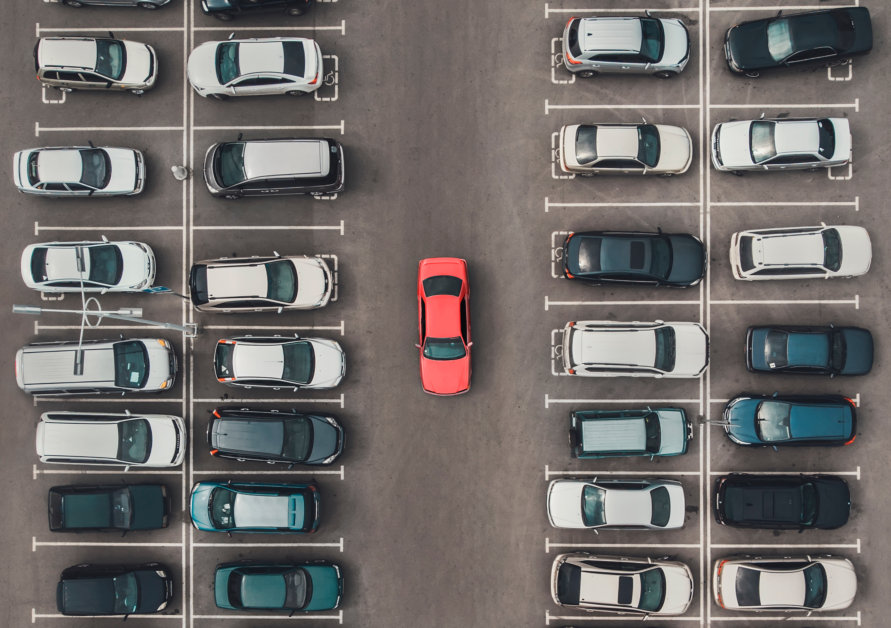

# Mini Project 2 — Object Counting (Hitung Jumlah Mobil)

**Mata Kuliah:** Pengolahan Citra dan Video

**Cakupan Materi:** Pertemuan 9–14 (Color Model, Segmentasi, Morfologi, Thresholding)

**Batas Pengumpulan:** Minggu ke-16

---

## Deskripsi Tugas

Anda diberikan sebuah foto **aerial (tampak atas) area parkir** yang berisi sejumlah mobil. Tugas Anda adalah **menghitung jumlah mobil** yang ada pada gambar tersebut menggunakan teknik pengolahan citra.

---

## Citra Input

### Foto Parkiran (Input Tugas)


> **Download gambar di atas sebagai input program Anda.**

---

## Persyaratan Teknis

### Wajib
1. **Bahasa:** Python
2. **Library yang diizinkan:**
   - `numpy` — operasi array dan numerik
   - `cv2` (OpenCV) — **boleh digunakan sepenuhnya** (termasuk fungsi processing)
   - `matplotlib` — untuk visualisasi
3. **Library yang DILARANG:**
   - Deep learning frameworks (TensorFlow, PyTorch, dll.)
   - YOLO, MediaPipe, atau model pre-trained lainnya
   - scikit-image, scikit-learn

> **Pada mini project ini, Anda boleh menggunakan seluruh fungsi OpenCV** (berbeda dengan aturan proyek utama). Tujuannya agar Anda bisa mengeksplorasi kapabilitas OpenCV secara penuh.

### Pendekatan yang Bisa Digunakan
Anda bebas memilih pipeline, beberapa pendekatan yang mungkin:

| Pendekatan | Teknik |
|------------|--------|
| Color-based | Konversi HSV/LAB → segmentasi warna mobil → counting |
| Edge-based | Grayscale → edge detection → contour finding → counting |
| Threshold-based | Grayscale → Otsu/adaptive threshold → morphology → connected components |
| Hybrid | Kombinasi beberapa pendekatan di atas |

> Tidak ada satu jawaban benar — yang penting pipeline Anda bisa **dijelaskan** dan hasilnya **reasonable**.

---

## Deliverables

Kumpulkan dalam **satu repository GitHub** (terpisah dari MP1) dengan struktur:

```
mp2-object-counting/
├── README.md              # Penjelasan pendekatan & cara menjalankan
├── counting.py            # atau .ipynb (Jupyter Notebook)
├── input/
│   └── parking.jpg        # Citra input
└── output/
    ├── result.png         # Citra output (mobil ditandai/diberi bounding box)
    └── steps/             # (opsional) visualisasi tiap tahap pipeline
```

### README.md harus berisi:
1. **Nama & NRP** 
2. **Jumlah mobil** yang terdeteksi oleh program Anda
3. **Penjelasan pipeline** — langkah per langkah, teknik apa yang dipakai dan alasannya
4. **Visualisasi tahapan** — tampilkan hasil tiap langkah (grayscale, threshold, morphology, dst.)
5. **Analisis** — kendala yang dihadapi, akurasi, apa yang bisa ditingkatkan
6. **Cara menjalankan** program

---

## Pengumpulan

- **Format:** Submit link repository GitHub ke Google Sheet yang telah disediakan
- **Deadline:** **Minggu ke-16**

---

## Tips

- Mulai dengan **eksplorasi visual**: tampilkan gambar dalam berbagai color space (HSV, LAB, grayscale) untuk melihat mana yang paling membedakan mobil dari aspal
- **Morphological operations** (opening, closing) sangat berguna untuk membersihkan hasil segmentasi
- Gunakan `cv2.findContours` atau `cv2.connectedComponentsWithStats` untuk menghitung objek
- Filter contour berdasarkan **area minimum/maksimum** untuk menghilangkan noise dan objek yang bukan mobil
- Coba visualisasikan **setiap tahap** pipeline Anda — ini membantu debugging dan juga bagian dari penilaian
- Tantangan utama: mobil berdekatan yang menyatu setelah thresholding — coba morphology atau watershed untuk memisahkan

Selamat mengerjakan!
